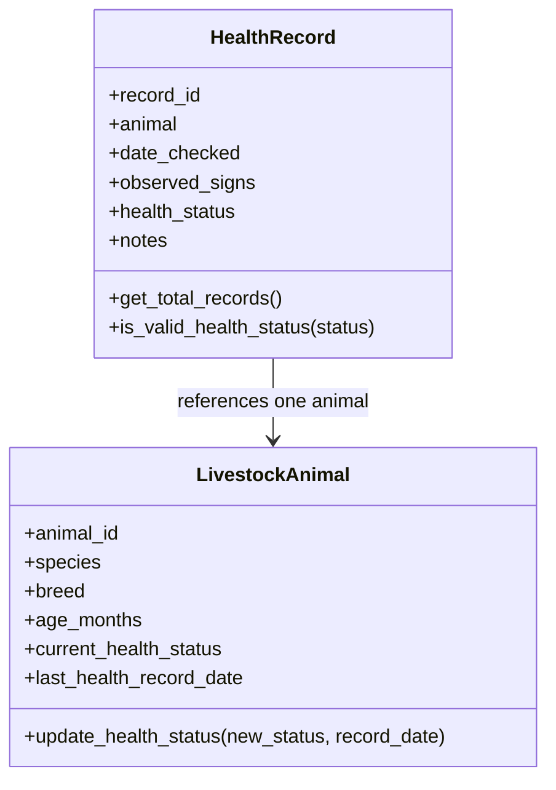
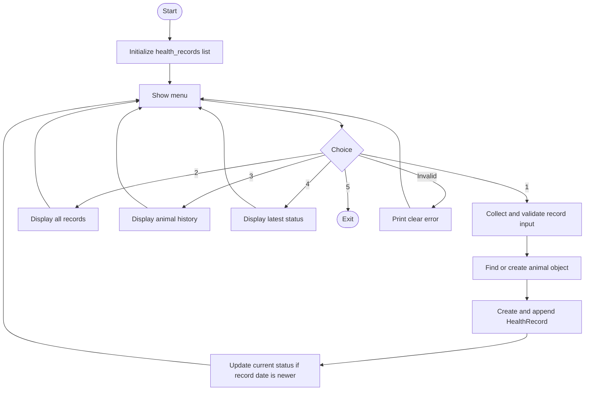

# Architecture and module guide

## Design goal

The application is intentionally layered so each file has a clear responsibility. This is an organizational improvement; it is not a change to the assignment's functional scope.

## Layers

### Models — `herd_health_tracker_app/models/`

- `livestock_animal.py`: defines `LivestockAnimal` and the instance method that updates the current status only for a newer record date.
- `health_record.py`: defines `HealthRecord`, its class-level counter, the class method, and the static status-validation method.

### Services — `herd_health_tracker_app/services/`

- `record_service.py`: searches the primary list, creates/reuses animal objects, adds records, and computes a summary tuple on demand. It does not ask for keyboard input.
- `demo_data.py`: defines the three fictional seed records and loads them using the same service function as normal records.

### User interface — `herd_health_tracker_app/ui/`

- `input_helpers.py`: asks for user input and loops until required values are valid.
- `record_entry.py`: coordinates the interactive record-entry workflow.
- `record_display.py`: formats a record and displays all records, one animal's history, or latest status.
- `menu.py`: prints the numbered menu.

### Utilities — `herd_health_tracker_app/utils/`

- `validation.py`: parses dates, ages and status entries. Parsing helpers return `None` for invalid date/age input where specified.

### Application entry points

- `herd_health_tracker_app/main.py`: creates the single primary `health_records` list and orchestrates the menu loop.
- `herd_health_tracker_app/__main__.py`: supports `python -m herd_health_tracker_app`.
- `herd_health_tracker.py`: maintains the simple original run command and re-exports public functions for compatibility.

## Data-flow rules

1. `main()` owns one primary list named `health_records`.
2. Services receive that list and operate on it; they do not keep a second persistent store.
3. Each `HealthRecord` references a `LivestockAnimal` object.
4. Multiple records for one animal ID reuse the same animal object.
5. A record's own date, observation and status stay as historical facts.
6. The animal's current status changes only when the new record date is strictly later.
7. The tuple summary is built from the main list when requested and is not retained.

## Why the launcher remains

The root `herd_health_tracker.py` file keeps the familiar command from the original project. The actual implementation lives in the package, avoiding a large monolithic source file while making the project easy to run for a beginner.

## Object relationship diagram

One `LivestockAnimal` object may be referenced by multiple `HealthRecord` objects. The program stores the records in the one primary `health_records` list.

## Application flow diagram

